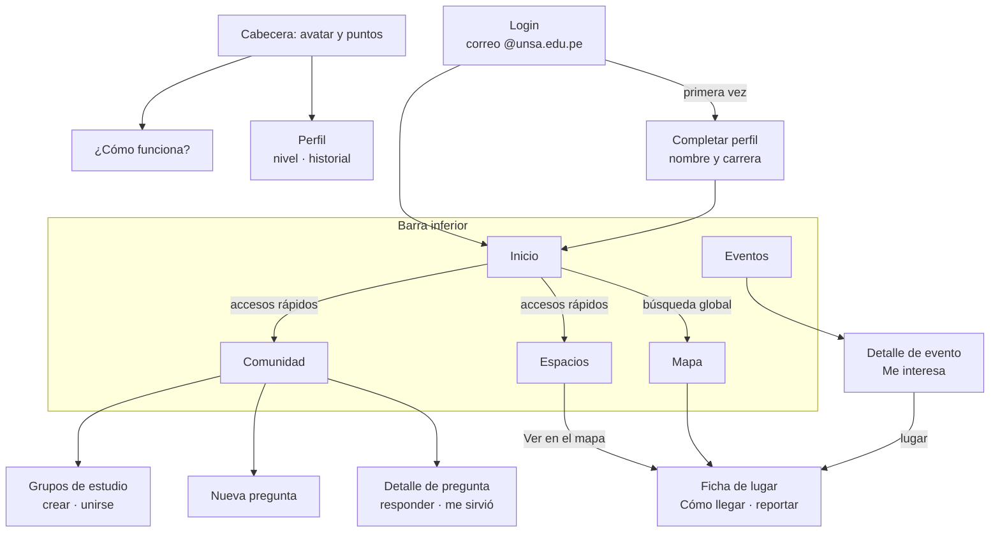

# UniYa — todo tu campus en una app

**Curso:** Interacción Humano-Computador (IHC) · **Entrega:** reunión de avance (Fase 1)
**Universidad:** Universidad Nacional de San Agustín de Arequipa (UNSA) · Área de Ingenierías

---

## 1. Problema

En el campus, los estudiantes (sobre todo los **cachimbos**) no encuentran aulas, laboratorios ni oficinas. No saben si hay sitio en la biblioteca, en las salas de estudio o en el estacionamiento hasta que llegan. Los eventos y talleres se pierden entre grupos de WhatsApp, y pedir ayuda (una duda de un curso, buscar grupo de estudio) depende de a quién conozcas.

### Usuarios

| Usuario | Qué necesita |
|---|---|
| Estudiante ingresante (cachimbo) | Ubicarse: encontrar aulas, oficinas y trámites. |
| Estudiante regular | Encontrar espacios libres, grupos de estudio y eventos. |
| Estudiante con auto | Saber si hay estacionamiento y, a veces, pedir ayuda. |
| Administrador u organizador | Publicar eventos y gestionar espacios. |

## 2. Objetivos

**Objetivo general:** facilitar la orientación, el acceso a espacios, la ayuda entre pares y la información de eventos en el campus mediante una app colaborativa centrada en el usuario.

**Objetivos específicos:**
1. **Mapa:** que un estudiante ubique cualquier aula, laboratorio u oficina del campus en menos de 30 segundos.
2. **Comunidad:** ofrecer un espacio de preguntas, respuestas y grupos de estudio entre estudiantes.
3. **Espacios:** mostrar la disponibilidad de bibliotecas, salas de estudio y estacionamientos con reportes colaborativos de un solo toque.
4. **Eventos:** reunir talleres, conferencias y actividades en una agenda filtrable.
5. **Usabilidad:** evaluar el prototipo con estudiantes reales mediante el cuestionario **SUS** y una evaluación con las **10 heurísticas de Nielsen**, y mejorar según los resultados.

## 3. Alcance

P1 = funciona en la feria · P2 = si alcanza el tiempo · P3 = idea futura

| Módulo | P1 | P2 | P3 |
|---|---|---|---|
| **Mapa del campus** | Marcadores por categoría, buscador con recientes, filtros, ficha de lugar y "Cómo llegar" con distancia a pie | Ruta a pie dibujada y "mi ubicación" (GPS) | Mapa por pisos |
| **Comunidad de ayuda** | Preguntas y respuestas (marcar la útil, filtrar), grupos de estudio (crear y unirse) | Proyectos interdisciplinarios, asistencia vehicular, niveles de reputación | — |
| **Disponibilidad de espacios** | Semáforo 🟢🟡🔴, "actualizado hace X min" y reporte en 1 toque con Deshacer | Check-in con QR (simulado), reserva de salas | Sensores o cámaras |
| **Información universitaria** | Agenda con filtros, detalle y "Me interesa" | Recordatorios y gestión de eventos (admin) | — |
| **Transversal** | Login con correo institucional, perfil con puntos, inicio (dashboard) | Rol de administrador, modo accesible | — |

## 4. Mapa de navegación

## 5. Tecnologías

| Capa | Tecnología | Por qué |
|---|---|---|
| Interfaz | **React 18 + Vite + TypeScript** | Componentes reutilizables (consistencia), arranque rápido y los tipos evitan errores. |
| Estilos | **Tailwind CSS** | Diseño *mobile-first* rápido y colores consistentes en toda la app. |
| Rutas | React Router | Cada pantalla tiene su URL; el botón "atrás" del celular funciona. |
| Estado | Zustand (+ `localStorage`) | Simple de explicar; los datos se guardan en el navegador en la Fase 1. |
| Mapa | **Leaflet + OpenStreetMap** | Gratis y sin API key. |
| Íconos | lucide-react | Íconos claros y uniformes. |
| Backend (Fase 2) | **Firebase**: Auth, Firestore, Hosting | Tiempo real entre celulares (`onSnapshot`) sin montar un servidor propio. |
| PWA (Fase 3) | vite-plugin-pwa | Instalar la app desde el QR del stand. |

**Decisión de arquitectura:** las pantallas nunca leen los datos directamente; todo pasa por `src/services/`. Hoy esos servicios usan datos de ejemplo; en la Fase 2 se cambian por Firebase **sin tocar las pantallas**.

## 6. Lo que ya está hecho (Fase 1)

- [x] Proyecto Vite + React + TypeScript + Tailwind, corriendo con `npm run dev`.
- [x] Login simulado con validación del correo `@unsa.edu.pe` y mensajes de error claros → registro en el primer ingreso → Inicio.
- [x] Navegación inferior con 5 secciones; el perfil se abre desde el avatar.
- [x] **Mapa:** 26 lugares reales del Área de Ingenierías (ubicación aproximada), filtros por categoría, búsqueda instantánea (sin tildes ni mayúsculas), búsquedas recientes, ficha de lugar y "Cómo llegar" con distancia y minutos a pie.
- [x] **Espacios:** 8 espacios con semáforo, "actualizado hace X min", gris si el dato tiene más de 60 min y reporte en 1 toque con **Deshacer**. Se refleja al instante en el Mapa y en el Inicio.
- [x] **Comunidad:** preguntas (crear, responder, marcar "me sirvió", filtrar por facultad o curso, eliminar con confirmación) y grupos de estudio (listar, crear, unirse, salir).
- [x] **Eventos:** agenda agrupada por día, filtros por fecha, tipo y facultad, detalle con enlace al mapa y "Me interesa" con contador.
- [x] **Perfil:** puntos que suben al aportar, niveles (Cachimbo → Colaborador → Mentor → Leyenda del campus) e historial de aportes.
- [x] Pantalla "¿Cómo funciona?" y estados vacíos que explican qué hacer.
- [x] Simulación de tiempo real: con la app abierta en dos pestañas, un reporte en una aparece al instante en la otra.
- [x] `npm run build` sin errores. Probado a 375 px sin errores en la consola.

### Heurísticas de Nielsen aplicadas (para la monografía)

En el código hay comentarios `// Heurística N: …` en cada punto clave.

| # | Heurística | Dónde se ve en UniYa |
|---|---|---|
| 1 | Visibilidad del estado | Toasts de confirmación, "actualizado hace X min", puntos siempre visibles en la cabecera, pestaña activa resaltada, esqueletos de carga. |
| 2 | Coincidencia con el mundo real | "Cachimbo", "pabellón", "aula"; semáforo de colores; íconos de cada tipo de lugar. |
| 3 | Control y libertad | **Deshacer** al reportar, responder, unirse, marcar útil o "Me interesa"; el botón "atrás" cierra la ficha del mapa. |
| 4 | Consistencia | Los mismos componentes (Card, Chip, StatusBadge, Toast) y los mismos colores del semáforo en Inicio, Mapa y Espacios. |
| 5 | Prevención de errores | Validación antes de enviar, confirmación antes de eliminar o descartar, botón desactivado si el grupo está lleno. |
| 6 | Reconocer antes que recordar | Chips de filtros, búsquedas recientes, sugerencias de cursos, leyenda del semáforo en pantalla. |
| 7 | Flexibilidad | Búsqueda global y accesos rápidos en el Inicio; Enter elige el primer resultado. |
| 8 | Diseño minimalista | Una acción principal por pantalla ("Cómo llegar", "Me interesa", "Hacer una pregunta"); reporte con 3 botones. |
| 9 | Mensajes de error útiles | Ej.: "Usaste @gmail.com. Solo se puede entrar con tu correo de la UNSA (termina en @unsa.edu.pe)". |
| 10 | Ayuda | Pantalla "¿Cómo funciona?" a un toque desde la cabecera y estados vacíos con instrucciones. |

**Accesibilidad:** objetivos táctiles de 44 px o más, foco visible, `aria-label` en botones con ícono, textos de 16 px en los campos y el estado nunca depende solo del color (siempre lleva texto).

## 7. Roles sugeridos (5 integrantes)

| Rol | Responsabilidades |
|---|---|
| Líder y monografía | Coordina, redacta la monografía y prepara la presentación. |
| Investigación UX y pruebas | Entrevistas, personas, pruebas con usuarios, SUS y evaluación heurística. |
| Diseño UI | Bocetos, guía visual, revisión de consistencia y accesibilidad. |
| Frontend | Pantallas y componentes en React. |
| Datos y Firebase | Datos del campus (coordenadas reales), Firebase Auth, Firestore y Hosting. |

## 8. Cronograma (4 semanas)

| Semana | Actividades |
|---|---|
| 1 | Investigación, bocetos y **Fase 1** (este avance). |
| 2 | Firebase y tiempo real entre celulares. |
| 3 | Módulos P2 y **pruebas con usuarios**. |
| 4 | Mejoras según el SUS, PWA y preparación de la feria. |

## 9. Preguntas para la profesora

1. ¿El alcance de 4 módulos está bien o recortamos alguno?
2. ¿Lo enfocamos solo en nuestra universidad (UNSA, Área de Ingenierías) o lo planteamos para cualquier campus?

---

*Los datos que muestra el prototipo son de ejemplo: los nombres de estudiantes son ficticios y la ubicación de los pabellones es aproximada.*
